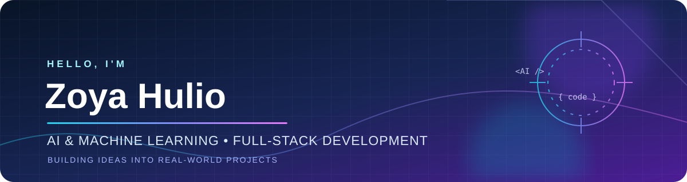
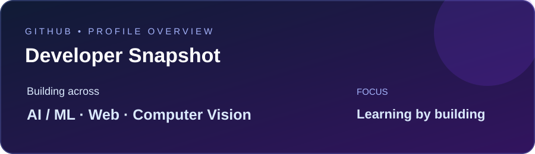
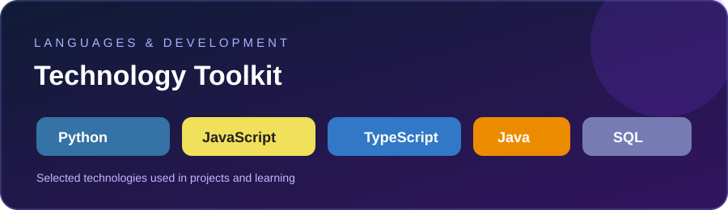
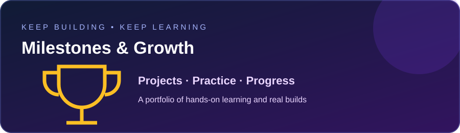

<!-- Animated-style profile header -->

  

<h3 align="center">Building useful products with code, data & AI ✨</h3>

  
  

---

## 👩‍💻 About Me

I'm a Computer Science student at **Sukkur IBA University**, interested in building practical software, AI-powered applications, and data-driven solutions.

Currently working as a **Front-End / AI Engineering Intern at FlyRank**, I enjoy turning ideas into working products and learning by building.

- 🔭 Exploring **AI/ML, computer vision, and full-stack development**
- 🌱 Strengthening my skills in **Python, TypeScript, machine learning, and cloud technologies**
- 💡 Interested in **Software Engineering, AI Engineering, and data-focused applications**
- 🤝 Open to internships, collaborations, and opportunities to build useful technology

---

## 🚀 Featured Projects

<table>
  <tr>
    <td width="50%" valign="top">
      <h3 align="center">📚 StudyMate AI</h3>
      

        
      

      
An AI-powered study assistant with streaming responses, concept lookup, and reliability-focused error handling.

      
<strong>Tech:</strong> Next.js · React · TypeScript · OpenRouter · AI SDK

      
<a href="https://study-mate-ai-lilac.vercel.app/">Live Demo ↗</a> · <a href="https://github.com/Zoya12-design/StudyMate-AI">Source Code ↗</a>

    </td>
    <td width="50%" valign="top">
      <h3 align="center">🖐️ GestureX</h3>
      

        
      

      
A computer-vision project that classifies hand gestures from hand landmarks and maps them to desktop actions.

      
<strong>Tech:</strong> Python · OpenCV · MediaPipe · scikit-learn

      
<a href="https://github.com/Zoya12-design/GestureX">Explore Project ↗</a>

    </td>
  </tr>
</table>

---

## 🧰 Tech Stack

### Languages & Web

  

### AI, Data & Cloud

  

### Tools & Design

  

  
  
  
  
  

---

## 🏅 Learning & Certifications

  
  
  
  

---

## 📊 GitHub Dashboard

  

  

  

> These are self-hosted visual cards, so they do not depend on third-party stats or trophy services. The technology card highlights selected tools, not a live ranking of repository language usage.

---

## 🌐 Let's Connect

  
  

<i>Always learning, building, and improving — one project at a time.</i>

  

